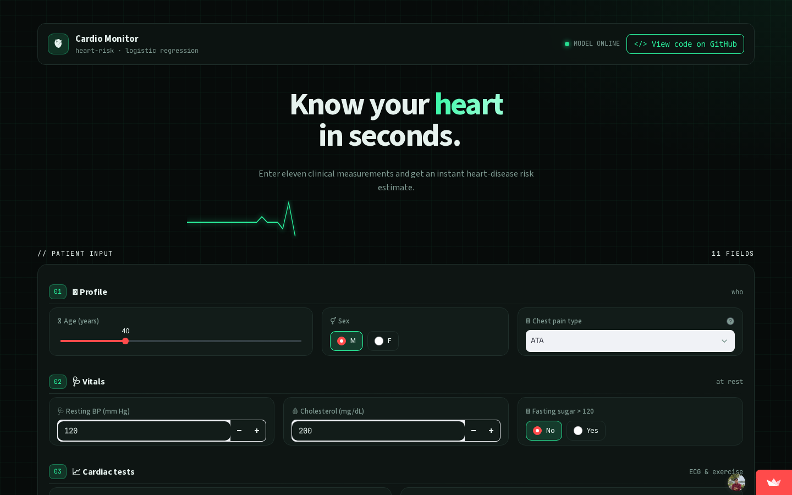

<div align="center">


# 🫀 Cardio Monitor — Heart Disease Prediction

**A machine learning web app that estimates a patient's risk of heart disease from 11 clinical attributes.**

[](https://cardio-monitor-ml.streamlit.app)
[](https://www.python.org/)
[](https://scikit-learn.org/)
[](#-model-comparison)


[**🚀 Try the Live App**](https://cardio-monitor-ml.streamlit.app) · [Report a Bug](https://github.com/priyam-10/heart-disease-prediction-ml/issues) · [Request a Feature](https://github.com/priyam-10/heart-disease-prediction-ml/issues)

</div>


---

## 📌 Overview

Cardiovascular disease is the **leading cause of death worldwide**. Early detection can save lives, and machine learning can help flag patients who may be at risk.

This project trains and compares five classification models on a clinical heart-disease dataset, selects the best-performing one (**Logistic Regression — 86.96% accuracy, 0.885 F1**), and serves it through an interactive **Streamlit** app styled as a dark "cardio monitor" dashboard.

### 📈 Key Highlights

<table align="center">
<tr>
<td align="center"><h3>918</h3>Patient Records</td>
<td align="center"><h3>11</h3>Clinical Features</td>
<td align="center"><h3>5</h3>Models Compared</td>
<td align="center"><h3>86.96%</h3>Test Accuracy</td>
<td align="center"><h3>0.885</h3>F1 Score</td>
</tr>
</table>

---

## 🌐 Live Demo

👉 **[cardio-monitor-ml.streamlit.app](https://cardio-monitor-ml.streamlit.app)**

<p align="center">
  <a href="https://cardio-monitor-ml.streamlit.app">
    
  </a>
</p>


---

## ✨ Features

- 🩺 **Instant risk prediction** from 11 patient attributes
- 🖥️ **Clinical-monitor UI** — dark theme with an animated ECG trace header
- 🧭 **Step-by-step input** — tabs for *Profile*, *Vitals* and *Cardiac Tests*
- 📊 **Visual results** — SVG risk gauge and vital-sign readouts
- ⚡ **Fast** — pre-trained model and scaler cached on load
- 🛡️ **Graceful error handling** if model files are missing

---

## 📊 Dataset

**Heart Failure Prediction dataset** — `heart.csv` · **918 records** · **11 features** + 1 target.

<details>
<summary><b>📋 Click to view all features</b></summary>
<br>

| Feature | Description | Type |
|---|---|---|
| `Age` | Age of the patient (years) | Numeric |
| `Sex` | `M` / `F` | Categorical |
| `ChestPainType` | `TA` typical angina, `ATA` atypical angina, `NAP` non-anginal pain, `ASY` asymptomatic | Categorical |
| `RestingBP` | Resting blood pressure (mm Hg) | Numeric |
| `Cholesterol` | Serum cholesterol (mg/dl) | Numeric |
| `FastingBS` | Fasting blood sugar > 120 mg/dl (`1` = yes, `0` = no) | Binary |
| `RestingECG` | `Normal`, `ST` (ST-T abnormality), `LVH` (left ventricular hypertrophy) | Categorical |
| `MaxHR` | Maximum heart rate achieved | Numeric |
| `ExerciseAngina` | Exercise-induced angina (`Y` / `N`) | Categorical |
| `Oldpeak` | ST depression induced by exercise | Numeric |
| `ST_Slope` | Slope of peak exercise ST segment (`Up`, `Flat`, `Down`) | Categorical |
| **`HeartDisease`** | **Target — `1` = heart disease, `0` = normal** | **Binary** |

</details>

### 🧾 Sample Input & Output

| Age | Sex | Chest Pain | Resting BP | Cholesterol | Max HR | Exercise Angina | ST Slope | ➜ Prediction |
|:---:|:---:|:---:|:---:|:---:|:---:|:---:|:---:|:---:|
| 40 | M | ATA | 140 | 289 | 172 | N | Up | 🟢 **Low Risk** |
| 49 | F | NAP | 160 | 180 | 156 | N | Flat | 🔴 **High Risk** |

---

## 🔬 ML Pipeline

<p align="center">
<code>📄 heart.csv</code> ➜ <code>🧹 Cleaning</code> ➜ <code>📊 EDA</code> ➜ <code>🔢 One-hot Encoding</code> ➜ <code>✂️ 80/20 Split</code> ➜ <code>⚖️ Scaling</code> ➜ <code>🤖 Train 5 Models</code> ➜ <code>🏆 Select Best</code> ➜ <code>💾 Export .pkl</code>
</p>

1. **Data Cleaning** — Invalid zero values in `Cholesterol` and `RestingBP` replaced with the mean of the non-zero values.
2. **Exploratory Data Analysis** — Distributions, count plots and a correlation heatmap.
3. **Encoding** — Categorical features one-hot encoded with `pd.get_dummies(drop_first=True)` → 15 input features.
4. **Splitting** — 80 / 20 train-test split (`random_state=42`).
5. **Scaling** — `StandardScaler` fit on training data only.
6. **Training & Evaluation** — Five classifiers compared on Accuracy and F1 score.
7. **Export** — Best model, scaler and column order saved with `joblib`.

---

## 🏆 Model Comparison

| Rank | Model | Accuracy | F1 Score | Accuracy Bar |
|:---:|---|:---:|:---:|---|
| 🥇 | **Logistic Regression** | **86.96%** | **0.8846** | `█████████████████░░░` |
| 🥈 | K-Nearest Neighbors | 86.41% | 0.8815 | `█████████████████░░░` |
| 🥉 | SVM (RBF Kernel) | 84.78% | 0.8667 | `████████████████░░░░` |
| 4 | Naive Bayes | 84.78% | 0.8614 | `████████████████░░░░` |
| 5 | Decision Tree | 79.89% | 0.8177 | `███████████████░░░░░` |

✅ **Logistic Regression** was selected for deployment — best accuracy and F1, plus it is simple, fast and interpretable.

### 🧠 Why Logistic Regression?

- **Best scores** — highest accuracy and F1 among all five models
- **Interpretable** — each feature's coefficient shows how it pushes risk up or down
- **Lightweight** — tiny model file, instant predictions in the browser app
- **Low overfitting** — performs well on unseen test data

### 🔍 Key Insights from EDA

- 📈 Risk **increases with age**, especially after 50
- 💔 **Asymptomatic (ASY)** chest pain is most common among heart-disease patients
- 🏃 **Exercise-induced angina** and a **Flat ST slope** are strong warning signs
- ❤️ Lower **maximum heart rate** is linked to higher risk
- 🧪 Zero values in `Cholesterol` / `RestingBP` were invalid and had to be fixed

---

## 🛠️ Tech Stack

| Category | Tools |
|---|---|
| Language | Python |
| Data Handling | Pandas, NumPy |
| Visualization | Matplotlib, Seaborn |
| Machine Learning | scikit-learn |
| Model Persistence | Joblib |
| Web App / Deployment | Streamlit, Streamlit Community Cloud |

---

## 📁 Project Structure

```
heart-disease-prediction-ml/
├── model/
│   ├── LR_model_heart.pkl   # Trained Logistic Regression model
│   ├── scaler.pkl           # Fitted StandardScaler
│   └── columns.pkl          # Expected feature column order
├── Heart.ipynb              # EDA, preprocessing & model training notebook
├── heart.csv                # Dataset
├── app.py                   # Streamlit web application
├── requirements.txt         # Python dependencies
└── README.md
```

---

## 🚀 Getting Started

### Prerequisites
- Python 3.9+
- pip

### Installation

```bash
# 1. Clone the repository
git clone https://github.com/priyam-10/heart-disease-prediction-ml.git
cd heart-disease-prediction-ml

# 2. (Optional) Create a virtual environment
python -m venv venv
source venv/bin/activate      # Windows: venv\Scripts\activate

# 3. Install dependencies
pip install -r requirements.txt

# 4. Run the app
streamlit run app.py
```

The app opens at **http://localhost:8501**.

### Retrain the model (optional)
Open `Heart.ipynb` in Jupyter / VS Code / Colab and run all cells to regenerate the `.pkl` files.

---

## ⚙️ How It Works

| Step | Stage | What happens |
|:---:|---|---|
| 1 | 👤 **User** | Enters patient details in the app |
| 2 | 🔢 **Encoding** | Inputs are one-hot encoded and reordered to match training columns |
| 3 | ⚖️ **Scaling** | Values standardized with the saved `scaler.pkl` |
| 4 | 🤖 **Model** | Logistic Regression predicts `0` or `1` |
| 5 | 📊 **Result** | App shows 🟢 Low Risk / 🔴 High Risk with a risk gauge |

1. The user enters patient details in the app.
2. Inputs are one-hot encoded to match the training format.
3. Columns are reordered using `columns.pkl`.
4. Values are standardized using the saved `scaler.pkl`.
5. The Logistic Regression model predicts **High Risk** or **Low Risk**.

---

## 🔮 Future Improvements

- [ ] Hyperparameter tuning with `GridSearchCV`
- [ ] Try ensemble models (Random Forest, XGBoost)
- [ ] Add explainability with SHAP
- [ ] Report precision, recall and ROC-AUC
- [ ] Downloadable PDF report of the prediction

---

## ❓ FAQ

<details>
<summary><b>Is this a medical diagnosis tool?</b></summary>
<br>No. It is an educational project and should never replace a doctor's advice.
</details>

<details>
<summary><b>Why does the live app take time to open?</b></summary>
<br>Free Streamlit apps go to sleep when unused. They wake up in about 30 seconds.
</details>

<details>
<summary><b>Can I use my own data?</b></summary>
<br>Yes — replace <code>heart.csv</code> with data in the same format, re-run <code>Heart.ipynb</code>, and the new model files will be saved to <code>model/</code>.
</details>

<details>
<summary><b>Which model is used in the app?</b></summary>
<br>Logistic Regression, chosen for having the best accuracy (86.96%) and F1 score (0.885).
</details>

---

## ⚠️ Disclaimer

This project is for **educational and research purposes only**. It is **not** a medical device and must not replace professional medical advice, diagnosis or treatment. Always consult a qualified healthcare provider.

---

## 🤝 Contributing

Contributions are welcome!

1. Fork the project
2. Create your branch: `git checkout -b feature/AmazingFeature`
3. Commit changes: `git commit -m "Add AmazingFeature"`
4. Push: `git push origin feature/AmazingFeature`
5. Open a Pull Request

---

## 📜 License

Distributed under the **MIT License**. See `LICENSE` for details.

---

## 🙏 Acknowledgements

- [Heart Failure Prediction Dataset — Kaggle](https://www.kaggle.com/datasets/fedesoriano/heart-failure-prediction)
- [scikit-learn](https://scikit-learn.org/) · [Streamlit](https://streamlit.io/) · [Shields.io](https://shields.io/)

---

## 👤 Author

**Priyam Singh**

_Machine Learning & Data Science Enthusiast_

[](https://github.com/priyam-10)

---

<div align="center">

⭐ **If you found this project helpful, please give it a star!** ⭐

Made with ❤️ and Python

</div>
